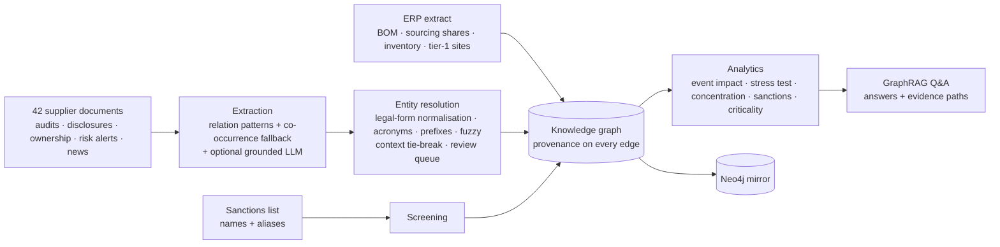

# Supply-Chain Knowledge Graph

[](https://github.com/raj75114043-design/supply-chain-knowledge-graph/actions/workflows/ci.yml)
[](https://raj-supply-chain-knowledge-graph.streamlit.app)


A supply-chain risk **knowledge graph** for a fictional EV manufacturer, Helix Motors. It joins ERP data with facts
extracted from unstructured supplier documents, resolves inconsistent company names, screens against a sanctions
list, and answers risk questions with **evidence paths** that cite the source of every hop.

> **Live console:** https://raj-supply-chain-knowledge-graph.streamlit.app — all companies, documents and figures are fictional.

---

## The problem

An ERP knows Helix's **tier-1** suppliers, the bill of materials and inventory. It does not know who supplies the
suppliers. That information sits in audit reports, sub-tier disclosures, ownership notices and news, which name the
same company in different ways ("Ganzhou Rare Earth Magnetics Co." / "Ganzhou Magnetics" / "GREM"). When an
earthquake hits Kumamoto, the ERP says only that Kiyomi Semiconductor is affected. The graph also finds this chain:

```
earthquake (Kyushu) → Kumamoto → Kyushu Specialty Gases → Shenzhen Brightway → charging-port module → every vehicle
   D-036              erp        D-006                     D-037 (analyst note)   erp
```

The result is **$460M of revenue at risk**. The ERP view alone puts it at $0, because Kiyomi's chips are covered by inventory.

## What it finds in this data

| Finding | How |
|---|---|
| **False dual sourcing** — both lithium-cell suppliers buy cathode material from Kunlun Lithium | Sub-tier relations from documents + common-upstream check |
| **Sanctions exposure three tiers down** — Ganzhou Magnetics is a subsidiary of a listed entity and feeds the drive motor and seats | Ownership extraction + fuzzy screening of names and aliases |
| **Hidden concentration** — one wafer foundry feeds three tier-1 electronics suppliers | Sub-tier fan-out analysis |
| **Inventory buffers** — a 2-week typhoon or a 6-week quake on chips with 6–8 weeks of stock costs nothing *directly* | Time-to-recover vs. time-to-survive per part |
| **Most critical supplier is tier-2** (Formosa Wafer, $1.6B at risk if lost for its recovery time) | Stress test of every supplier |

## Pipeline



**Ontology:** `Product → Assembly → Part → Supplier`, `Supplier -SUPPLIES→ Supplier` (sub-tier), `SUBSIDIARY_OF`,
`LOCATED_IN → City → Region`, `Event -AFFECTS→ Region | City | Supplier`, `SANCTIONS_MATCH → SanctionsEntry`.

**Impact model:** for each part, *share lost* × *max(0, disruption weeks − inventory weeks)*. A vehicle needs every
part, so the worst part sets the product's loss. Revenue at risk = weekly revenue × lost weeks.

## Entity resolution, the hard part

| Mention | Resolved to | Rule |
|---|---|---|
| `VCS` | Volta Cell Systems Co., Ltd. | acronym |
| `Kiyomi Semi` | Kiyomi Semiconductor K.K. | ordered token prefix |
| `Brightway` | Shenzhen Brightway Electronics Co., Ltd. | distinctive-token subset (place names ignored) |
| `Penang Precision Tooling` | *new company* — not the sensor supplier | below threshold |
| `Volta Mobility Ventures`, `Kiyomi Foods`, `Arclight Media` | kept separate | look-alike traps |
| `Penang Precision` (in a news item) | **review queue** | ties two entities; guessing is not allowed |
| `Penang Precision` (in a supply statement) | Penang Precision Sensors | context tie-break toward the ERP supplier |

## Evaluation

`python -m sckg.eval.run --gate` compares the pipeline with gold annotations, and the analytics on the pipeline graph
with the same analytics on a graph built from gold facts.

| Metric | Result | Gate |
|---|---|---|
| Relation extraction precision / recall (26 gold triples) | 100% / 100% | ≥ 95% precision, ≥ 95% seen recall |
| … recall on phrasing the patterns were **not** written for (2 triples) | 100% via co-occurrence fallback | reported |
| Entity resolution B-cubed F1 (54 mentions incl. 4 look-alike companies) | 1.00, 0 false merges, 1 sent to review | ≥ 0.95, 0 false merges |
| Event impact agreement with gold graph (6 events) | 6/6 | ≥ 95% |
| Hidden concentration / sanctions exposure agreement | match / match | exact |
| GraphRAG QA (19 golden questions incl. paraphrases and out-of-scope) | 19/19 | ≥ 90% |

**Read these numbers honestly.** The documents are generated from templates, and the relation patterns were written
for that language, so precision and seen-phrasing recall are expected to be high. The more telling results are these:
- The two **unseen-phrasing** sentences, before the fallback extractor existed, took recall to 0 for those relations.
  That turned a $460M earthquake exposure into $0. The evaluation caught it; see [docs/evaluation.md](docs/evaluation.md).
- The **look-alike companies**, which test entity-resolution precision.
- The **ambiguous mention**, which goes to a review queue instead of being guessed.

The co-occurrence fallback is tested on only two sentences. On real documents it needs the review workflow it flags for.

The **integration job** loads the graph into Neo4j and checks that a Cypher impact query returns the same products as the
Python analytics for every event.

## Quick start

```bash
pip install -r requirements-dev.txt
make test eval                                   # 17 tests + quality gate
make console                                     # http://localhost:8501
python -m sckg.cli ask "What is the impact of the Kyushu earthquake?"
```

```bash
cp .env.example .env && docker compose up --build    # Neo4j (http://localhost:7474) + API + console
```

## Repository layout

```
sckg/
  data/generator.py   ERP extract, documents, sanctions list and gold annotations (reproducible; CI checks)
  extract.py          sentence splitting, relation patterns, event extraction, co-occurrence fallback, optional LLM
  resolve.py          company-name normalisation, scoring, resolver with review queue
  pipeline.py         extraction → resolution → screening → graph
  graph.py            ontology and provenance-carrying graph
  analytics.py        event impact, stress test, single source, hidden concentration, sanctions, criticality, explanations
  qa.py               GraphRAG question answering with evidence paths
  neo4j_store.py      Neo4j mirror and Cypher impact query
  api.py · cli.py · eval/run.py
data/raw/             erp.json · documents.jsonl · sanctions.json · regions.json      data/gold.json
streamlit_app.py      risk console
```

## Design decisions

- [ADR-0001](docs/adr/0001-provenance-on-every-edge.md) — provenance on every edge; answers are evidence paths
- [ADR-0002](docs/adr/0002-entity-resolution-precision-first.md) — entity resolution favours precision; ambiguity goes to people
- [ADR-0003](docs/adr/0003-networkx-core-neo4j-mirror.md) — NetworkX as the pipeline's graph, Neo4j as a verified mirror
- [ADR-0004](docs/adr/0004-ttr-vs-tts-impact-model.md) — time-to-recover vs. time-to-survive impact model

## Limitations and roadmap

- Pattern extraction is tuned to the document styles here; the grounded LLM extractor (`LLM_EXTRACTION=1`) and the review queue are the path to new sources.
- Impact assumes the unaffected source of a dual-sourced part cannot flex; capacity data would refine it.
- Roadmap: supplier capacity and alternate-part substitutions, event feeds (GDACS, port status), temporal edges (relations valid from/to), Neo4j as primary store at scale.

## Licence

MIT
